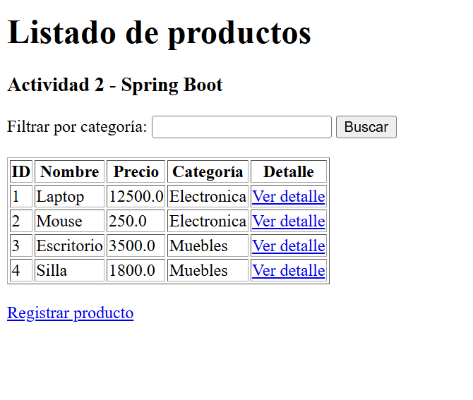
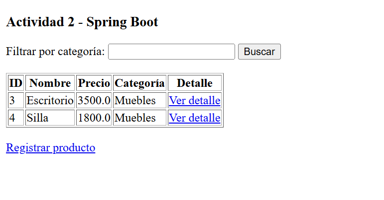
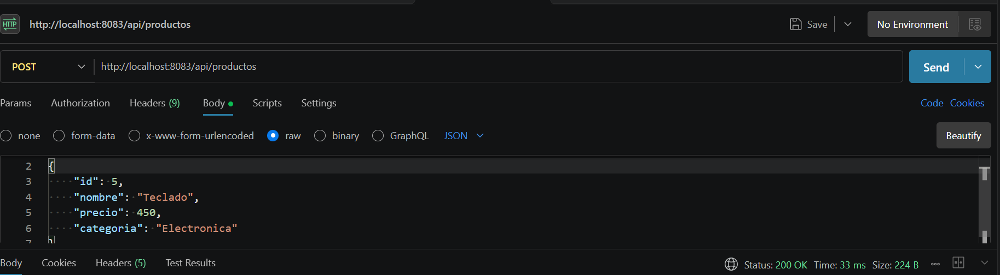
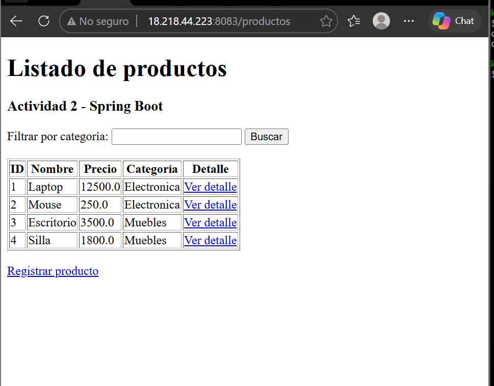

# Actividad 2 - Spring Boot

## Introducción

En esta actividad se desarrolló una aplicación web utilizando Spring Boot, con el objetivo de implementar el patrón MVC, trabajar con controladores, utilizar DTO y manejar diferentes tipos de peticiones HTTP. También se implementaron vistas dinámicas mediante Thymeleaf y se realizó el despliegue de la aplicación en un servidor VPS.

## Tecnologías utilizadas

- Java 23
- Spring Boot 4.1.2
- Spring Web
- Thymeleaf
- Maven
- Git y GitHub
- Amazon EC2
- Postman

## Funcionalidades implementadas

### 1. Listado de productos

Se creó una vista que muestra los productos registrados utilizando Thymeleaf y el atributo `th:each`. Los datos son enviados desde el controlador mediante `Model`.

Ruta:
`/productos`

### 2. Formulario de productos

Se implementó un formulario para registrar productos utilizando `@ModelAttribute`, permitiendo recibir los datos enviados desde la vista.

Ruta:
`/productos/formulario`

### 3. Uso de @RequestParam

Se implementó un filtro de productos por categoría utilizando `@RequestParam`, que permite recibir parámetros enviados mediante la URL.

Ejemplo:

`/productos/filtrar?categoria=Electronica`

### 4. Uso de @PathVariable

Se creó una ruta para consultar los detalles de un producto mediante su identificador utilizando `@PathVariable`.

Ejemplo:

`/productos/detalle/1`

### 5. Implementación de DTO

Se creó la clase `ProductoDTO` para transportar información de los productos entre las diferentes capas de la aplicación, evitando utilizar directamente una entidad en las peticiones y respuestas.

### 6. Endpoint POST con @RequestBody

Se implementó un controlador REST que recibe información en formato JSON mediante `@RequestBody` y registra un nuevo producto.

Endpoint:

`POST /api/productos`

Ejemplo de JSON:

```json
{
  "id": 5,
  "nombre": "Teclado",
  "precio": 450,
  "categoria": "Electronica"
}
```

## Estructura del proyecto

```text
src/
 └── main/
     ├── java/
     │   └── com/karlmt/spring/app1/springboot_actividad2/
     │       ├── controllers/
     │       │   ├── ProductoController.java
     │       │   └── ProductoRestController.java
     │       ├── dto/
     │       │   └── ProductoDTO.java
     │       ├── services/
     │       │   └── ProductoService.java
     │       └── SpringbootActividad2Application.java
     │
     └── resources/
         ├── templates/
         │   ├── lista.html
         │   ├── formulario.html
         │   └── detalle.html
         └── application.properties
```

## Configuración del proyecto

En el archivo `application.properties` se configuró el puerto 8083 y propiedades personalizadas:

```properties
spring.application.name=springboot-actividad2
server.port=8083
app.nombre=Actividad 2 - Spring Boot
app.autor=Karla Martinez
```

## Ejecución local

Para ejecutar el proyecto localmente:

```bash
./mvnw spring-boot:run
```

La aplicación estará disponible en:

`http://localhost:8083/productos`

## Pruebas realizadas

Se realizaron pruebas de las siguientes funcionalidades:

- Visualización del listado de productos.
- Registro de productos mediante formulario.
- Filtrado de productos por categoría.
- Consulta de detalles mediante identificador.
- Registro de productos mediante petición POST en Postman.

### Evidencias

#### 1. Listado de productos



#### 2. Formulario de productos


#### 3. Filtro mediante @RequestParam



#### 4. Detalle mediante @PathVariable


#### 5. Petición POST en Postman




## Despliegue en VPS

La aplicación se desplegó en un servidor Amazon EC2 utilizando Java 21.

Se generó el archivo JAR mediante Maven:

```bash
./mvnw clean package
```

Posteriormente, se transfirió el archivo JAR al servidor y se ejecutó en segundo plano:

```bash
nohup java -jar springboot-actividad2-0.0.1-SNAPSHOT.jar --server.port=8083 > actividad2.log 2>&1 &
```

### Acceso a la aplicación desplegada

`http://18.218.44.223:8083/productos`

Puerto utilizado: **8083**

Las actividades anteriores permanecen ejecutándose en sus respectivos puertos.

Desplegado en Vps


## Repositorio

[MBKact2_t4 - GitHub](https://github.com/Karl335-lm/MBKact2_t4)

## Conclusión

Con esta actividad se reforzaron los conocimientos sobre Spring Boot y el patrón MVC, implementando controladores, vistas dinámicas con Thymeleaf, DTO y diferentes mecanismos para recibir información mediante peticiones HTTP. Además, se practicó la generación de archivos JAR, el uso de GitHub y el despliegue de una aplicación en un servidor VPS.


